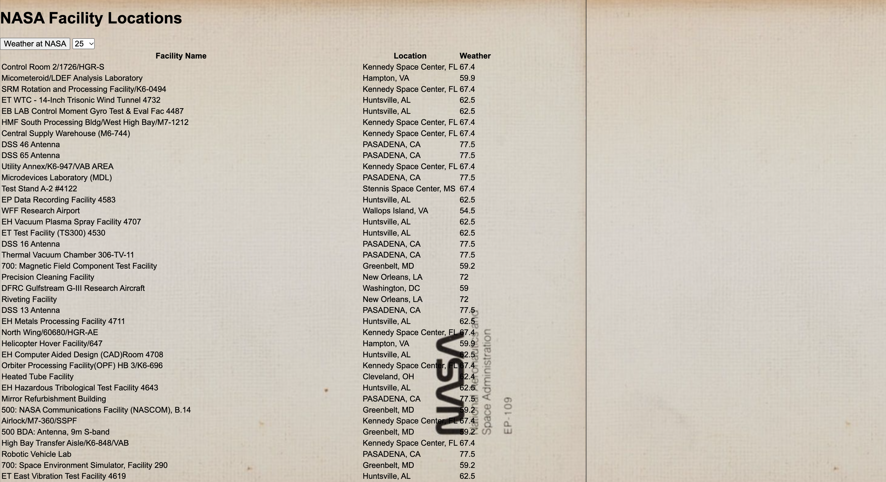

# Complex NASA 🚀

A page that lists NASA facility locations and shows the current temperature at each one.

## Description

This is a project I built to practice working with more than one API at once. When you click the button, the page gets NASA's list of facility locations, then uses each facility's city to ask a weather API for the current temperature. Everything is shown in a table with the facility name, its location, and the weather. You can choose how many facilities to show, from 25 up to all of them. It uses plain HTML, CSS, and JavaScript with `fetch`, so there is no server to run.

## Screenshot

<!-- Replace the file name below with your own screenshot. Put the picture in the screenshots folder.
     Mac tip: Cmd + Shift + 4, then drag a box around the app. -->

## Features

- Gets NASA's facility locations from NASA's open data
- Choose how many facilities to show: 25, 50, 100, or all
- Shows each facility's name and its city and state
- Shows the current temperature (in °F) for each facility's city
- Space background image

## Tech Used

- HTML
- CSS
- JavaScript
- `fetch` and promises (`.then()`)
- NASA Open Data (the facilities list)
- [WeatherAPI](https://www.weatherapi.com/) 

## How to Use

This app needs a WeatherAPI key.

1. Download or clone the project.
2. Make an account at [weatherapi.com](https://www.weatherapi.com/) and copy your API key.
3. Open `js/main.js` and put your key after `key=` in the weather URL.
4. Open `index.html` in your browser.
5. Choose how many facilities you want to see in the dropdown.
6. Click **Weather at NASA**.

## How It Works

1. When you click the button, `main.js` reads how many facilities you chose.
2. It uses `fetch` to get the NASA facilities list as JSON. The request goes through a proxy so the browser is allowed to read it.
3. For each facility, it adds a row to the table with the name and the city and state.
4. It then sends the facility's city to WeatherAPI and adds the current temperature to that row when the answer comes back.

## What I Learned

- How to use `fetch` and `.then()` to get data from an API
- How to use data from one API to ask a second API for more information
- How to turn JSON into table rows with JavaScript
- How to read a dropdown value to change what the page shows

## Author

Maya Rose 🌹
